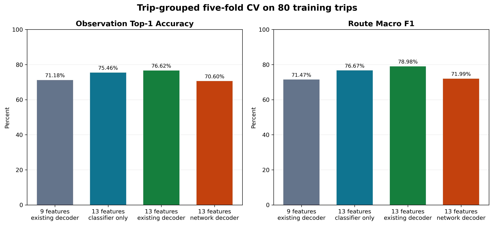

# PathSnap Phase 1–2 Audit and Accuracy Experiment

## Status

Phase 1 repository and integration audit is complete. One bounded five-fold feature experiment has completed on the 80 training trips. Its results are recorded under `artifacts/experiments/local-features-cv-20261118T094436Z/`. The experiment improved training-fold Top-1 from 71.18% to 76.62% with the existing decoder. It did not reach the 85–90% target.

The existing 9-feature model artifact remains unchanged. The new 13-feature configuration has not yet been fitted as a final all-training artifact or evaluated on `student_test`, so it is a promising validated configuration, not yet the integrated model.

## Phase 1: repository audit

The repository contains the five individual scikit-learn model scripts, the shared candidate and feature pipeline in `pathsnap.py`, five-fold model comparison in `experiments.py`, Optuna tuning, decoder evaluation, timestamped model artifacts, plots, a FastAPI service, and a small browser client. Root Python files parse successfully. The GitHub remote is `logiclayer25/PathSnap`, branch `main`; commit `7fd6d752e5a8855128d1573370bbe85ac1f5d852` contains the previously completed project work.

### Data and candidate pipeline

- 80 training trips and 10 `student_test` trips are present in the supplied dataset.
- The audit found no missing trip files, invalid coordinate rows, invalid arc-node references, invalid route-arc references, non-increasing timestamps, non-finite candidate features, or invalid candidate arc IDs.
- Timestamp gaps exist: 7,284 non-1-second steps in training and 264 in `student_test`; 1,216 training steps and 44 `student_test` steps exceed five seconds.
- At 24 candidates and nine original features, the candidate miss rate is 4.98% across training observations and 0.23% on `student_test`. The maximum per-trip training miss rate is 60.34%, so some trips have a low ceiling before ranking errors are considered.
- The original nine features are point-to-arc distance, heading error, arc length, along-arc fraction, GPS speed, elapsed-time progress, step displacement, timestamp gap, and heading alignment cosine.

### Model, backend, and UI integration

- The current API loads `artifacts/models/histgb-20261118T070402Z.pkl` and expects the original nine-feature pipeline. It has `/health`, `/predict`, and a dataset-trip prediction endpoint. It omits `.route` when loading a dataset trip and does not return reference labels.
- Local FastAPI smoke checks have passed for health, prediction, and CORS. A local prediction on one trip in the evaluator folder returned successfully in earlier work. A real two-laptop network check has not been completed.
- The current browser client accepts pasted JSON only. It has no file upload control, interactive route map, or prediction summary beyond the raw API response. The UI page has been opened locally, but the browser-to-API workflow has not been verified end to end in a browser.
- The new 13-feature pipeline is not yet connected to the model artifact or API. The API must continue using the existing 9-feature artifact until a compatible model is trained and validated.

## Phase 2: controlled feature experiment

The single approved experiment used `HistGradientBoostingClassifier` with the saved Optuna parameters, 24 candidates, seed 42, and five-fold `GroupKFold` by trip across all 80 training trips. The same trip folds were used for the nine-feature and 13-feature comparisons. The experiment did not read `student_test` or `evaluator_test`.

Four local context features were added to the existing nine: smoothed heading over nearby GPS samples, previous GPS point distance to each candidate road, next GPS point distance to each candidate road, and the mean of the two neighboring distances. The candidate generation, labels, training trips, candidate count, estimator configuration, and decoder stayed fixed.

| Decoder on out-of-fold predictions | Top-1 | Macro F1 | Candidate miss rate | Route continuity |
|---|---:|---:|---:|---:|
| Original 9 features, existing decoder | 71.18% | 71.47% | 4.98% | 99.03% |
| 13 features, classifier only | 75.46% | 76.67% | 4.98% | 93.03% |
| 13 features, existing decoder | **76.62%** | **78.98%** | 4.98% | 99.02% |
| 13 features, network-aware decoder best setting | 70.60% | 71.99% | 4.98% | 96.02% |

The 13-feature existing-decoder result is a **5.44 percentage-point** aggregate Top-1 improvement over the 71.18% baseline. Fold Top-1 values were 82.26%, 88.09%, 52.64%, 80.06%, and 83.32%; the low third fold shows substantial trip-to-trip variation. The new network-distance decoder did not improve Top-1 and is not selected.

The experiment uses grouped held-out folds, so the reported improvement is not based on training predictions. It tests the four contextual features as one group; it does not estimate each new feature's separate contribution. HistGradientBoosting has no native `feature_importances_` attribute, and no additional permutation or ablation experiment was run.

### Selected model status and accuracy limit

The current validation choice is the 13-feature HGB recipe with the **existing decoder**: 76.62% observation-weighted CV Top-1. The original 9-feature model remains the API model until the 13-feature model has a final all-training fit and a `student_test` check. The 85–90% goal remains unmet. Training candidate misses alone account for 4.98% of observations; ranking errors account for the remaining gap.

The local `evaluator_test` folder is ignored by Git. A prior one-time score was generated before the current instruction to keep that set untouched; the new phase-2 experiment did not access it, and it must not be used for any further selection or tuning.

## Experiment files

- `feature_accuracy_cv.py`: reproducible local-feature GroupKFold experiment.
- `artifacts/experiments/local-features-cv-20261118T094436Z/results.json`: parameters, fold assignments, fold metrics, and aggregate metrics.
- `artifacts/experiments/local-features-cv-20261118T094436Z/comparison.csv`: compact metric table.
- `artifacts/decoding/network-hmm-cv-20261118T092658Z/results.json`: five-fold comparison of the existing decoder and network-distance settings.
- `artifacts/decoding/hmm-transition-cv-20261118T075330Z/results.json`: saved selection of the existing 60 m, zero transition-weight decoder.

## Prioritized remaining work

1. After approval for one final training pass, fit the selected 13-feature model on all 80 training trips to a new timestamped artifact; preserve the existing artifact.
2. Evaluate that new artifact once on `student_test`. Keep `evaluator_test` out of all future work.
3. If the student-test result supports the CV result, update the API feature path and selected model atomically; otherwise retain the current 9-feature model.
4. Complete the frontend with trip-file upload and an interactive map, then test its request against the API.
5. Test multiple real trips end to end and complete the two-laptop network check.
6. Generate the final integrated application report and screenshots after those checks.
